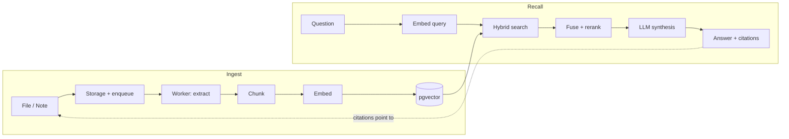
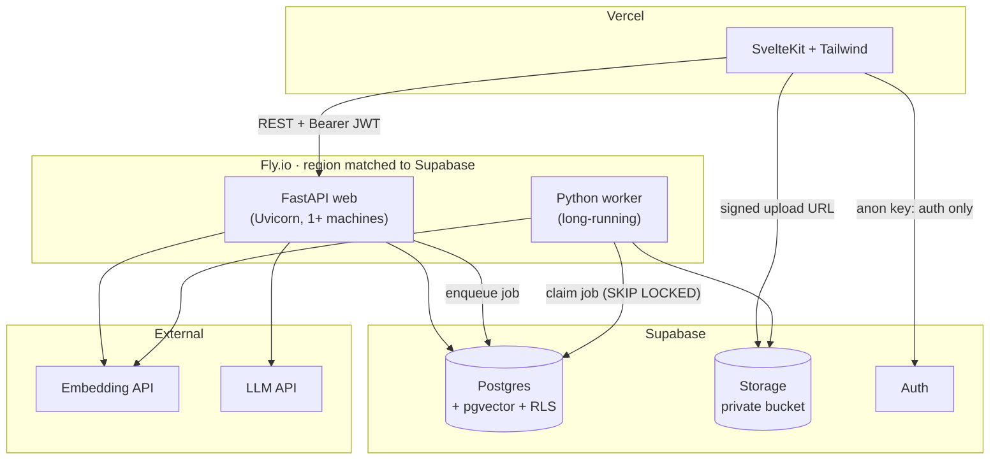
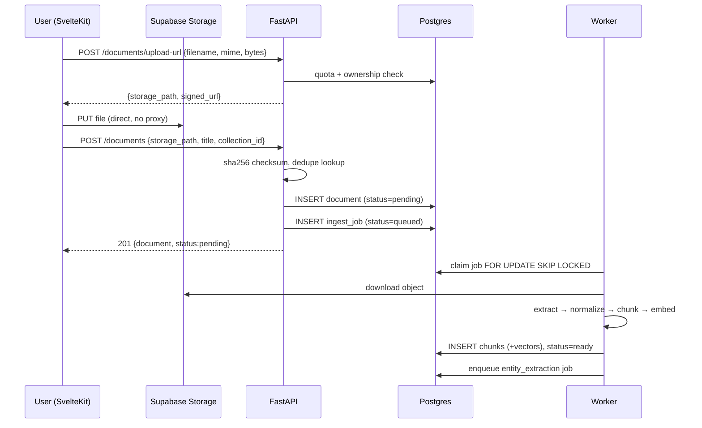
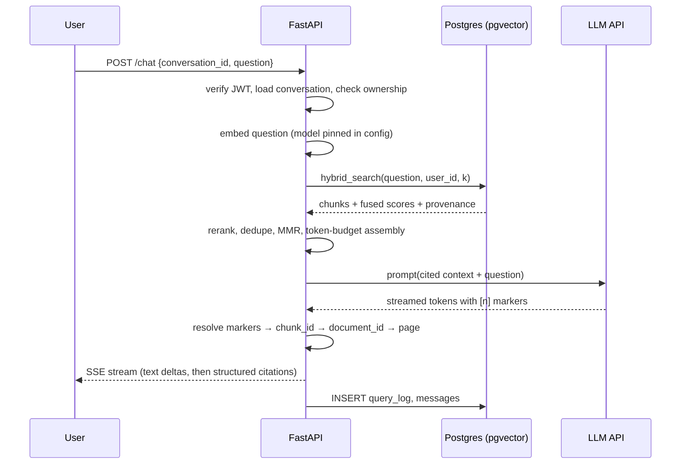

# NEXUS — System Architecture

Status: **design (spec phase)** · Audience: individual users now, multi-tenant SaaS later
Last updated: 2026-11-22

---

## 1. Product definition

NEXUS is an AI-powered Personal Knowledge Management System. It is **cloud-hosted**, **citation-first**, and built so that one user's knowledge never leaks into another's answers.

### 1.1 The five responsibilities

| # | Duty | What it means concretely |
|---|------|--------------------------|
| 1 | **Capture** | Accept notes, uploaded files (PDF / DOCX / TXT / MD), and saved conversations. Store originals in Supabase Storage, extract text asynchronously. |
| 2 | **Organize** | Collections, tags, metadata, document status. Every item is owned by exactly one user. |
| 3 | **Understand** | Chunk + embed content, extract entities, summarize. Produces a searchable representation separate from the raw file. |
| 4 | **Connect** | Derive entity ↔ entity and document ↔ document relationships, surfaced in a graph view. |
| 5 | **Recall** | Answer natural-language questions from retrieved chunks only, with inline citations back to the source document and location. |

### 1.2 The design principle that overrides everything

> **NEXUS must never answer from an LLM's parametric memory.**
> Every factual claim in an answer is traceable to a stored chunk, and that chunk is traceable to a document the user owns.

This is an *architectural* constraint, not a prompt style. It forces:

- **Retrieval-before-generation** on every request — there is no "chat with no context" code path.
- **Citations as structured data**, not markup the model invents. The server maps `[n]` markers to real `chunk_id`s after generation; markers the model fabricates are stripped.
- **An explicit refusal path** — if retrieval confidence is low, the system says "not in your knowledge base" instead of guessing. A confident wrong answer is the worst possible failure mode for a memory tool.
- **Multi-tenant schema from day one** — `user_id` on every row, RLS enforcing it, because a retrieval bug that crosses tenants is a data breach, not a UI glitch.

---

## 2. Layers

The layer boundaries from the reference design are the **code ownership boundaries**. Nothing crosses a layer upward except through a documented interface.

### 1. Presentation — SvelteKit · Tailwind · TypeScript
Owns: Dashboard, Notes, Documents, Collections, Search, AI Chat, Graph.
Holds **only** `PUBLIC_SUPABASE_URL`, `PUBLIC_SUPABASE_ANON_KEY`, `PUBLIC_API_BASE_URL`.
Never holds: service-role key, LLM/embedding API keys, chunking logic, prompts.

### 2. Application — FastAPI · REST · Auth · Business logic
Owns: request validation, Supabase JWT verification, ownership checks, document lifecycle, collection CRUD, conversation state, RAG orchestration, citation resolution, streaming.
This is the **only** service allowed to speak to the LLM and embedding providers.

### 3. Data — Supabase Postgres + pgvector + RLS
Owns: truth. Users, documents, chunks, vectors, entities, jobs, conversations, audit/query logs.
See [DATABASE.md](./DATABASE.md).

### 4. Storage — Supabase Storage
Owns: original bytes (PDF/DOCX/TXT/MD), private bucket, path-prefixed per user.
The application layer never proxies file bytes through itself; clients upload via short-lived signed URLs.

### 5. AI Intelligence — Python · embeddings · RAG · LLM
Owns: text extraction, normalization, structure-aware chunking, embedding, retrieval, fusion, reranking, context assembly, prompt construction, summarization, entity/knowledge extraction.
See [RAG-PIPELINE.md](./RAG-PIPELINE.md).

### 6. Background processing — worker · job queue · retries
Owns: everything slow or failure-prone. Extraction, embedding, entity extraction, graph updates, retries, dead-lettering.
Runs as a **separate Fly.io process** from the API so a 400-page PDF can never stall a chat request.

---

## 3. Trust boundaries and key handling

| Key | Location | Scope |
|-----|----------|-------|
| `SUPABASE_ANON_KEY` | Vercel env, shipped to browser | Auth flows + RLS-constrained reads only |
| `SUPABASE_SERVICE_ROLE_KEY` | Fly secret — **never** Vercel | Bypasses RLS. Used only by the worker and specific system operations |
| `OPENAI_API_KEY` / embedding key | Fly secret | Application + worker only |
| `SUPABASE_JWT_SECRET` or JWKS | Fly secret | Verifying inbound user tokens |

**Two database clients, deliberately.** The API keeps a `db_user` client built with the caller's JWT so RLS applies to user-facing reads and writes — a bug in application code then cannot cross tenants. A `db_admin` service-role client is available but is restricted by convention to job enqueueing and worker operations, and every use is code-reviewable. This is defense in depth: the ownership check exists in Python *and* in Postgres.

The browser talks to Supabase directly for auth and signed uploads only. All ranked, generated, or privileged data flows through FastAPI.

---

## 4. Request flows

### 4.1 Ingest (upload)

### 4.2 Recall (ask)

### 4.3 Re-index (note edited)

A note's body lives in `documents.raw_text`. Saving a note increments `documents.version` and enqueues `reindex`, which deletes chunks of the prior version and re-chunks. This keeps edited notes from producing stale or duplicate hits.

---

## 5. Invariants

These must hold at all times. They are the things worth writing tests against.

1. **No row without an owner.** Every user-scoped table has `user_id NOT NULL` and an RLS policy. No exceptions, including join tables.
2. **No answer without a source.** The chat endpoint returns `citations: []` with `grounded: false` when retrieval yields nothing usable. It never returns prose alone.
3. **No chunk without a document.** `chunks.document_id` cascades on delete; deleting a document purges its chunks, entities links, and storage object.
4. **No status lie.** `documents.status = 'ready'` implies its chunks exist and are queryable. Partial ingest leaves `'processing'` at a known step, never `'ready'`.
5. **Idempotent processing.** Reprocessing a document (retry, reindex) converges to the same chunk set for the same version. Writes are version-guarded so a stale worker cannot overwrite fresh chunks.
6. **Prompt context is data, not instruction.** Retrieved text is delimited and explicitly framed as untrusted content. A document containing "ignore previous instructions" must not change system behaviour.
7. **One embedding model per index.** Model ID and dimension are pinned in a single config module; changing either is a migration, not a config tweak.

---

## 6. Decisions (ADR summary)

### ADR-001 — Single Postgres primary; no read replicas
The reference diagram shows a primary/replica cluster. Supabase sells read replicas as an add-on, and at this stage they would add cost and replication-lag complexity for zero benefit. We design for one primary and keep heavy read paths (retrieval, listing) as pure `SELECT`s with no cross-statement transactions, so a replica can be introduced later without code changes.

### ADR-002 — Postgres-backed job queue instead of Redis
A `jobs` table with `FOR UPDATE SKIP LOCKED` gives at-least-once delivery, retries, backoff, dead-lettering, and full observability through SQL — with no extra service, no separate auth, and no cache-invalidation coherence problem. Redis survives in the design as an optional response/embedding cache *after* latency data justifies it. MVP needs a queue, not a cache.

### ADR-003 — Notes and documents share one `documents` table
Notes and uploads differ only in origin. Unifying them means one chunking path, one search path, one citation shape, one RLS policy, and one UI listing query — and a note can later become a document, or a conversation saved to knowledge becomes a `documents` row with `source_type = 'note'`. The discriminator column is `source_type`; uploads carry `storage_path`, notes carry `raw_text`. Polymorphic `chunks.source_id` is rejected because it destroys referential integrity and RLS simplicity.

### ADR-004 — Fly.io for API + worker, Vercel for frontend
Vercel cannot host long-lived Python processes. Fly runs both the API and the worker as separate processes in a region co-located with the Supabase project, with machines that stay warm and a shared private network. A shared `Dockerfile` keeps the deployment portable to Railway/Render if we move.

### ADR-005 — Hybrid search implemented in SQL, not a vector service
"Hybrid search engine" is not a product here; it is a single Postgres function combining pgvector cosine similarity with `tsvector` ranking via Reciprocal Rank Fusion. One database, one consistency model, no sync pipeline. A managed vector DB becomes interesting only well past the point where our corpus outgrows Postgres.

### ADR-006 — RLS as the tenant boundary, not application filters
Application-level `WHERE user_id = ?` is one forgotten clause away from a breach. Policies on every table mean the database refuses cross-tenant reads regardless of what the Python does.

### ADR-007 — Deferred deliberately
| Deferred | Why | Revisit when |
|---|---|---|
| Redis cache | No latency data yet | p95 retrieval > 300 ms |
| Prometheus / Grafana | JSON logs + `/health` cover MVP diagnosis | First 10 real users |
| OCR for scanned PDFs | Most personal PDFs have a text layer | First user reports an image-only PDF |
| Read replicas | See ADR-001 | Sustained read saturation |
| Workspaces / org tenancy | Audience is individuals | First team or sharing request |
| Auth beyond owner role | No sharing feature exists | Collections gain collaborators |
| Audio/video ingestion | Needs transcription pipeline | Explicitly requested |

---

## 7. Non-goals for the MVP

Real-time collaboration, public sharing links, mobile app, browser extension, offline mode, fine-tuning, agentic multi-step tool use, custom model hosting.

---

## 8. Related documents

- [DATABASE.md](./DATABASE.md) — tables, indexes, RLS policies
- [RAG-PIPELINE.md](./RAG-PIPELINE.md) — extraction, chunking, retrieval, grounding
- [API.md](./API.md) — endpoints, payloads, errors
- [DEVELOPMENT.md](./DEVELOPMENT.md) — Vercel + Fly.io, secrets, environments
- [ROADMAP.md](./ROADMAP.md) — build order
