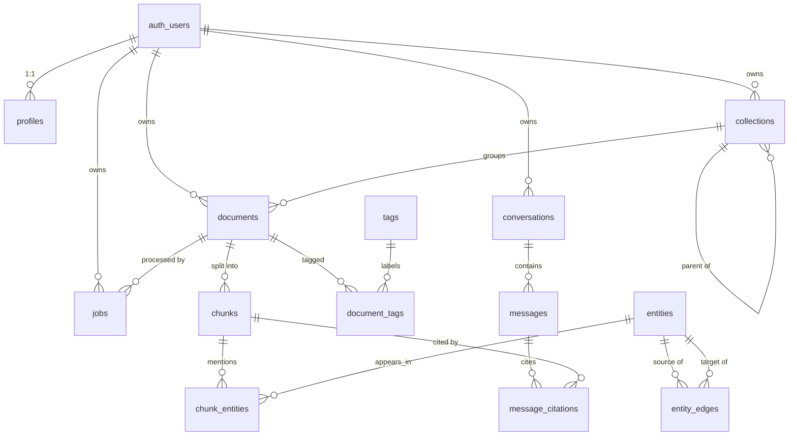

# NEXUS — Data Model

Status: **design (spec phase)** — no migrations written yet
Target: Supabase Postgres 15+ · pgvector · RLS on every user-scoped table

---

## 1. Conventions

| Convention | Rule |
|---|---|
| Primary keys | `uuid`, `DEFAULT gen_random_uuid()` |
| Owner column | `user_id uuid NOT NULL REFERENCES auth.users(id) ON DELETE CASCADE` |
| Timestamps | `created_at`, `updated_at` as `timestamptz NOT NULL DEFAULT now()`; `updated_at` maintained by trigger |
| Enum-ish columns | `text` + `CHECK` constraint, not native enums (easy to extend without `ALTER TYPE` locks) |
| JSON | `jsonb` for provider metadata, extraction stats, and flexible attributes only — never for anything queried in a `WHERE` on a hot path |
| Deletes | Hard delete with `ON DELETE CASCADE` from `documents` down. Soft delete only on `documents` (`deleted_at`) so an accidental purge is recoverable for 30 days |
| RLS | Enabled on every user-scoped table. Policy shape is identical everywhere: `user_id = auth.uid()` |
| Naming | snake_case, plural tables, `_id` suffix on FKs |

---

## 2. Entity map



---

## 3. Tables

### 3.1 `profiles`
Mirror of `auth.users` for app-level fields. One row per user, created by an `AFTER INSERT` trigger on `auth.users`.

| Column | Type | Notes |
|---|---|---|
| `id` | `uuid PK` | `REFERENCES auth.users(id) ON DELETE CASCADE` |
| `display_name` | `text` | |
| `timezone` | `text` | IANA name; used for date-relative retrieval hints |
| `default_embedding_model` | `text` | Pinned model id for this user's index |
| `created_at` / `updated_at` | `timestamptz` | |

RLS: user may `SELECT`/`UPDATE` own row only. No `INSERT` policy — the trigger owns row creation (runs as `SECURITY DEFINER`).

---

### 3.2 `collections`
Hierarchical folders. Depth capped in the API (max 3 levels) rather than in SQL.

| Column | Type | Notes |
|---|---|---|
| `id` | `uuid PK` | |
| `user_id` | `uuid NOT NULL` | |
| `parent_id` | `uuid NULL` | Self-FK, `ON DELETE SET NULL`; `CHECK (parent_id <> id)` |
| `name` | `text NOT NULL` | `CHECK (char_length BETWEEN 1 AND 120)` |
| `description` | `text` | |
| `color` | `text` | UI only |
| `position` | `int` | Manual ordering |
| `created_at` / `updated_at` | `timestamptz` | |

Indexes: `(user_id, parent_id)`, unique `(user_id, coalesce(parent_id,'00000000-0000-0000-0000-000000000000'::uuid), lower(name))` to prevent duplicate sibling names.

---

### 3.3 `documents`
**One table for uploads and notes.** `source_type` discriminates; both share the same chunk + retrieval path (see ADR-003).

| Column | Type | Notes |
|---|---|---|
| `id` | `uuid PK` | |
| `user_id` | `uuid NOT NULL` | |
| `collection_id` | `uuid NULL` | `ON DELETE SET NULL` — deleting a folder must not delete knowledge |
| `source_type` | `text NOT NULL` | `CHECK IN ('upload','note','conversation')` |
| `title` | `text NOT NULL` | |
| `mime_type` | `text` | `application/pdf`, `text/markdown`, … |
| `storage_path` | `text NULL` | `{user_id}/{document_id}/{filename}`; `NULL` for notes |
| `file_size` | `bigint NULL` | Bytes |
| `checksum_sha256` | `text NULL` | Dedupe key, computed by the API |
| `raw_text` | `text NULL` | Normalized extracted text; notes store their body here |
| `page_count` | `int NULL` | Drives citation granularity for PDFs |
| `status` | `text NOT NULL` | `CHECK IN ('pending','processing','ready','failed','archived')` |
| `processing_stage` | `text NULL` | `extracting` / `chunking` / `embedding` / `entities` — powers honest progress UI |
| `error_message` | `text NULL` | Populated on `failed` |
| `version` | `int NOT NULL DEFAULT 1` | Incremented on edit; guards stale worker writes |
| `embedding_model` | `text NULL` | Model that produced this doc's vectors |
| `summary` | `text NULL` | Generated at ingest, used for doc-level search and graph labels |
| `metadata` | `jsonb DEFAULT '{}'` | `{author, created_date, extraction_method, language}` |
| `deleted_at` | `timestamptz NULL` | Soft delete; excluded from all queries, purged by scheduled job |
| `created_at` / `updated_at` | `timestamptz` | |

Constraint: `CHECK ((source_type = 'upload' AND storage_path IS NOT NULL) OR (source_type <> 'upload'))`.
Constraint: `CHECK (status <> 'ready' OR id IN (SELECT document_id FROM chunks))` is **not** expressible as a simple CHECK — enforced in the worker's finalizing transaction (insert chunks, then flip status, same transaction).

Indexes:
- `(user_id, status, updated_at DESC)` — dashboard listing
- `(user_id, collection_id)`
- `(user_id, checksum_sha256)` partial `WHERE deleted_at IS NULL` — dedupe
- GIN on `to_tsvector('english', title || ' ' || coalesce(raw_text,''))` — document-level keyword search
- `(user_id) WHERE status IN ('pending','processing')` — stuck-job sweeper

---

### 3.4 `chunks`
The retrieval unit and the citation unit. One row = one embeddable passage.

| Column | Type | Notes |
|---|---|---|
| `id` | `uuid PK` | |
| `user_id` | `uuid NOT NULL` | Denormalized from `documents` **on purpose** so RLS and filters never need a join |
| `document_id` | `uuid NOT NULL` | `ON DELETE CASCADE` |
| `ordinal` | `int NOT NULL` | Position in document, 0-based |
| `content` | `text NOT NULL` | Verbatim passage — what gets cited and quoted |
| `token_count` | `int` | For context budgeting |
| `char_start` / `char_end` | `int` | Offsets into `documents.raw_text` — citation highlighting |
| `page_start` / `page_end` | `int NULL` | For PDFs |
| `heading_path` | `text NULL` | e.g. `"Chapter 3 > Deployment > Secrets"` — structure-aware context |
| `embedding` | `vector(1536)` | Dimension pinned to the configured model |
| `embedding_model` | `text NOT NULL` | Guards against mixing model spaces |
| `metadata` | `jsonb DEFAULT '{}'` | `{chunk_strategy, overlap, extraction_flags}` |
| `created_at` | `timestamptz` | |
| `version` | `int NOT NULL DEFAULT 1` | Mirrors the document version that produced it |

Unique: `(document_id, ordinal, version)`.
Indexes:
- **HNSW** `USING hnsw (embedding vector_cosine_ops) WITH (m=16, ef_construction=64)` — vector candidate generation
- **GIN** `USING gin (to_tsvector('english', content))` — keyword candidates
- `(user_id, document_id, ordinal)`

> Note on HNSW + RLS: a filtered vector search still walks the graph, so heavily filtered queries can under-return. Mitigation at scale is iterative scanning (`hnsw.iterative_scan`) or partition-per-tenant; at current corpus sizes plain HNSW with a `user_id` filter is comfortably fast. This is documented as a known scaling consideration rather than pre-solved.

---

### 3.5 `tags` and `document_tags`

`tags`: `id`, `user_id`, `name` (`CHECK char_length BETWEEN 1 AND 60`), `created_at`. Unique `(user_id, lower(name))`.

`document_tags`: `document_id` (`ON DELETE CASCADE`), `tag_id` (`ON DELETE CASCADE`), `user_id NOT NULL`, PK `(document_id, tag_id)`. `user_id` is duplicated here specifically so the RLS policy can be the standard single-column form without a join.

---

### 3.6 `entities` — the "Connect" layer

| Column | Type | Notes |
|---|---|---|
| `id` | `uuid PK` | |
| `user_id` | `uuid NOT NULL` | |
| `name` | `text NOT NULL` | Normalized surface form |
| `normalized_name` | `text NOT NULL` | Lowercased, trimmed, article-stripped — the merge key |
| `entity_type` | `text` | `person` / `organization` / `project` / `concept` / `place` / `event` / `other` |
| `description` | `text` | LLM-generated, one line, always derived from cited chunks |
| `first_seen_at` / `last_seen_at` | `timestamptz` | Recency signal for ranking |
| `mention_count` | `int` | Materialized counter, updated by worker |
| `created_at` / `updated_at` | `timestamptz` | |

Unique `(user_id, normalized_name)`.

`chunk_entities`: `chunk_id` (`ON DELETE CASCADE`), `entity_id` (`ON DELETE CASCADE`), `user_id`, `confidence numeric(3,2)`, PK `(chunk_id, entity_id)`.

`entity_edges`: `id`, `user_id`, `source_entity_id`, `target_entity_id`, `relation` (`text`, free-form short label from a constrained prompt), `weight int` (co-occurrence count), `created_at`.
Unique `(user_id, source_entity_id, target_entity_id, relation)`. Both FKs `ON DELETE CASCADE`.

Graph queries are 1–2 hops from a seed entity, capped in the API. No recursive CTE beyond depth 3.

---

### 3.7 `conversations` and `messages`

`conversations`: `id`, `user_id`, `title` (auto-generated from the first question), `created_at`, `updated_at`, `archived_at`.

`messages`:
| Column | Type | Notes |
|---|---|---|
| `id` | `uuid PK` | |
| `user_id` | `uuid NOT NULL` | |
| `conversation_id` | `uuid NOT NULL` | `ON DELETE CASCADE` |
| `role` | `text NOT NULL` | `CHECK IN ('user','assistant','system')` |
| `content` | `text NOT NULL` | Rendered text with `[n]` markers |
| `grounded` | `boolean` | `false` when retrieval returned nothing usable |
| `retrieval_debug` | `jsonb NULL` | `{query_variants, candidate_counts, fused_scores, dropped}` — the audit trail for "why did it answer that" |
| `model` | `text NULL` | LLM id + version |
| `tokens_in` / `tokens_out` | `int NULL` | Cost tracking |
| `latency_ms` | `int NULL` | |
| `created_at` | `timestamptz` | |

`message_citations`: `id`, `user_id`, `message_id` (`ON DELETE CASCADE`), `chunk_id` (`ON DELETE CASCADE`), `document_id`, `marker int` (the `n` in `[n]`), `quote text`, `page int NULL`, `score numeric`.
**`chunk_id` is `ON DELETE CASCADE`, `document_id` is `RESTRICT`-free but stored denormalized** so a citation list still renders if a document is later archived. Deleting a cited document removes the citation; the message keeps its text.

---

### 3.8 `jobs` — the queue

| Column | Type | Notes |
|---|---|---|
| `id` | `uuid PK` | |
| `user_id` | `uuid NOT NULL` | Preserves RLS symmetry and lets a user see their own queue |
| `document_id` | `uuid NULL` | `ON DELETE CASCADE` |
| `job_type` | `text NOT NULL` | `ingest` / `reindex` / `entities` / `summary` / `purge` |
| `status` | `text NOT NULL` | `queued` / `running` / `succeeded` / `failed` / `dead` |
| `priority` | `int NOT NULL DEFAULT 100` | Lower runs first |
| `attempts` | `int NOT NULL DEFAULT 0` | |
| `max_attempts` | `int NOT NULL DEFAULT 5` | |
| `run_after` | `timestamptz NOT NULL DEFAULT now()` | Backoff gate |
| `locked_by` | `text NULL` | Worker id |
| `locked_at` | `timestamptz NULL` | Staleness detection |
| `payload` | `jsonb DEFAULT '{}'` | `{version, stage, force}` |
| `last_error` | `text NULL` | |
| `created_at` / `updated_at` | `timestamptz` | |

Index: `(status, priority, run_after) WHERE status = 'queued'` — the claim query's only index.

Claim pattern:
```sql
UPDATE jobs SET status='running', locked_by=$1, locked_at=now(), attempts=attempts+1
WHERE id = (
  SELECT id FROM jobs
  WHERE status='queued' AND run_after <= now()
  ORDER BY priority, run_after
  FOR UPDATE SKIP LOCKED
  LIMIT 1
)
RETURNING *;
```
Retry policy: exponential backoff `min(60 * 2^attempts, 3600)` seconds into `run_after`. `attempts >= max_attempts` → `dead` + a visible "processing failed" state in the UI. A sweeper requeues rows where `status='running'` and `locked_at < now() - interval '15 minutes'` (worker crash recovery).

---

### 3.9 `usage_events` (lightweight, for quota + debugging)

`id`, `user_id`, `event_type` (`chat` / `embed` / `ingest`), `document_id NULL`, `tokens int`, `cost_estimate numeric(10,6)`, `created_at`.

No RLS read policy for end users beyond their own rows; primarily an operations table. Keeps the multi-tenant future honest about per-tenant cost.

---

## 4. RLS policy template

Applied verbatim to every user-scoped table, with `user_id` the only varying identifier:

```sql
ALTER TABLE <table> ENABLE ROW LEVEL SECURITY;

CREATE POLICY "<table>_select_own" ON <table>
  FOR SELECT USING (user_id = auth.uid());

CREATE POLICY "<table>_insert_own" ON <table>
  FOR INSERT WITH CHECK (user_id = auth.uid());

CREATE POLICY "<table>_update_own" ON <table>
  FOR UPDATE USING (user_id = auth.uid())
  WITH CHECK (user_id = auth.uid());

CREATE POLICY "<table>_delete_own" ON <table>
  FOR DELETE USING (user_id = auth.uid());
```

`chunks`, `message_citations`, and `chunk_entities` are written by workers using the service-role client, which bypasses RLS. They still carry `user_id` and keep the `SELECT`-own policy so the user's own reads are constrained, and the insert policy means a mis-scoped worker write is still rejected if it ever runs under a user token.

`jobs`: users get `SELECT` only; all mutations are service-role.

---

## 5. Storage layout

```
nexus-documents/            (private bucket)
└── {user_id}/
    └── {document_id}/
        └── {sanitized_filename}
```

- Bucket is private. Access is exclusively via short-lived signed URLs (upload: 5 min, download: 60 s).
- Storage RLS policy keys on the first path segment: `(storage.foldername(name))[1] = auth.uid()::text`.
- Deleting a `documents` row enqueues a `purge` job; the object is removed by the worker, not by cascade — object storage has no FK.

---

## 6. Migration order

1. Extensions: `vector`, `pgcrypto`, `pg_trgm` (typo tolerance on entity name merge)
2. `profiles` + `auth.users` trigger
3. `collections`, `documents`, `tags`, `document_tags`
4. `chunks` + HNSW/GIN indexes (indexes created **after** data load in prod; on an empty schema, inline is fine)
5. `entities`, `chunk_entities`, `entity_edges`
6. `conversations`, `messages`, `message_citations`
7. `jobs` + `usage_events`
8. RLS enablement + policies (a single migration, auditable in one diff)
9. `hybrid_search` function + `updated_at` trigger function

---

## 7. Open questions to resolve before migrations

| Question | Default if unresolved |
|---|---|
| Embedding model + dimension (1536 vs 1024 vs 3072) | `text-embedding-3-small` @ 1536 — cheap, adequate, dimension-stable |
| Retention of `raw_text` after chunking | Keep it; enables re-chunking without re-downloading originals |
| Max upload size | 50 MB / 500 pages per document |
| Per-user storage quota | 2 GB soft cap, enforced in `upload-url` |
| Conversation retention | Indefinite, user-deletable |
| Whether `documents.raw_text` should move to a `document_texts` side table | Only if row-size/bloat becomes measurable; keep inline for MVP |
