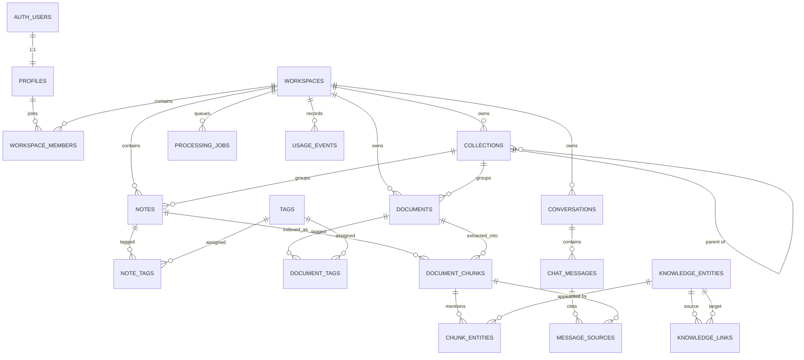

# NEXUS — Data Model

Status: **implemented** — 11 migrations in `supabase/migrations/`, validated on Postgres 16
Target: Supabase Postgres 15+ · pgvector · RLS on every workspace-scoped table

---

## 1. The tenancy decision

Everything belongs to a **workspace**. There is no fully-qualified table row anywhere in the
schema that is owned by a bare user.

```
auth.users ──1:1── profiles
auth.users ──1:n── workspace_members ──n:1── workspaces
```

Why from day one, even for a single-user tool: the ownership column is the thing that is most
expensive to add later. A `user_id` scheme is not "workspace-less tenancy" — it is a schema in
which every table, index, policy, query, and API route has to be rewritten when sharing arrives.
Adding one row (`workspace_members`) to a workspace-scoped schema is cheap; retrofitting the
concept is not.

The concrete consequences, all of which are visible in the migrations:

| Consequence | Where |
|---|---|
| Every tenant table has `workspace_id` | `0002`–`0006` |
| Every policy is membership-based, not owner-based | `0007` |
| Signup creates a workspace, not just a profile | `handle_new_user()` in `0001` |
| Storage paths start with the workspace id | `0009` |
| Every API route is `/v1/workspaces/{workspace_id}/…` | `apps/api/app/api/routes` |

### 1.1 Roles

| Role | Read | Write content | Manage members | Delete workspace |
|---|---|---|---|---|
| `owner` | ✓ | ✓ | ✓ | ✓ (non-personal only) |
| `admin` | ✓ | ✓ | ✓ | ✗ |
| `member` | ✓ | ✓ | ✗ | ✗ |
| `viewer` | ✓ | ✗ | ✗ | ✗ |

`owner` is enforced as **exactly one per workspace** by a partial unique index
(`workspace_members_one_owner`), not by application logic.

The role ladder is expressed twice on purpose:

* in SQL — `workspace_role()`, `can_write_workspace()`, `can_manage_workspace()` (SECURITY DEFINER
  helpers with `set search_path = public, pg_temp`);
* in Python — `app.core.tenancy.ROLE_RANK`, so an endpoint can reject a request without a round
  trip.

The database is the authority. The Python copy exists to produce a clear `403`, not to decide.

### 1.2 Two mechanisms, one boundary

A cross-tenant read has to defeat both of these:

1. **Explicit intent** — the route resolves `{workspace_id}` through `resolve_workspace()`, which
   joins `workspace_members` for the caller. Not a member → `404` (never `403`; the API does not
   confirm that a stranger's workspace exists).
2. **Row-level security** — the request's connection is bound to `authenticated` with
   `request.jwt.claim.sub` set, so even a query with a wrong `workspace_id` returns no rows.

`supabase/tests/tenancy.sql` and `apps/api/tests/db/test_api_workspaces.py` assert both.

---

## 2. Entity map



Eighteen tables:

```
profiles            workspaces           workspace_members
collections         notes                documents            tags
note_tags           document_tags        document_chunks
knowledge_entities  chunk_entities       knowledge_links
conversations       chat_messages        message_sources
processing_jobs     usage_events
```

---

## 3. Conventions

| Convention | Rule |
|---|---|
| Primary keys | `uuid`, `DEFAULT gen_random_uuid()` |
| Tenant column | `workspace_id uuid NOT NULL REFERENCES workspaces(id) ON DELETE CASCADE` on every tenant table |
| Authorship | `created_by` / `uploaded_by` → `auth.users(id)`, informational and nullable for system writes |
| Timestamps | `created_at`, `updated_at` `timestamptz NOT NULL DEFAULT now()`; `updated_at` maintained by the `set_updated_at()` trigger |
| Enum-ish columns | `text` + `CHECK`, not native enums (extensible without `ALTER TYPE` locks) |
| JSON | `jsonb` for provider metadata and extraction stats only — never for a column queried in a hot `WHERE` |
| Deletes | Soft delete (`deleted_at`) on `notes` and `documents`; hard delete below them. A `purge` job removes bytes and rows after the retention window |
| RLS | Enabled on **all 18** tables. No table is readable by `anon` |
| Naming | snake_case, plural tables, `_id` suffix on foreign keys |

Two redundant guards are deliberate rather than accidental:

* **`workspace_id` is denormalised onto child rows** (`document_chunks`, `note_tags`,
  `message_sources`, …). It costs one column and buys an index that makes the tenant predicate
  part of every plan, and it lets a policy check membership without joining upward.
* **Consistency is enforced by constraint**, not trust. Composite foreign keys and `CHECK`s make
  a cross-workspace link impossible to insert even with service-role access.

### 3.1 Composite foreign keys: the third layer

A plain foreign key proves that the parent row *exists*. It does not prove the parent is in the
**same workspace**. Since `workspace_id` is denormalised onto children, the two facts could drift
apart: a service-role script, a future worker bug, or a hand-written migration could file a chunk
under workspace A while pointing at a note in workspace B. RLS would hide the damage on reads and
the row would linger — corrupting retrieval silently.

Every parent table therefore exposes `(id, workspace_id)` as a unique key, and every child points
at the *pair*:

```sql
alter table public.document_chunks
  add constraint document_chunks_note_workspace_fkey
    foreign key (note_id, workspace_id) references public.notes (id, workspace_id)
    on delete cascade;
```

Applied to:

| Child | Constrained to the same workspace as |
|---|---|
| `document_chunks` | its `note` **or** its `document` (both keys, XOR picks one) |
| `note_tags`, `document_tags` | the note/document and the tag |
| `chunk_entities` | the chunk and the entity |
| `knowledge_links` | `source_id` and `target_id` |
| `chat_messages` | its conversation |
| `message_sources` | the message and the chunk |

This is the "workspace-consistency constraint" the database design calls for, and it is the only
one of the three layers that still holds when the connection is service-role and RLS is bypassed
entirely. Verified by attempting all seven cross-tenant shapes in `supabase/tests/tenancy.sql`;
each is refused with a foreign-key violation.

---

## 4. Tables

### 4.1 `profiles`
One row per user, created by the `handle_new_user()` trigger on `auth.users`.

| Column | Type | Notes |
|---|---|---|
| `id` | `uuid` PK | same value as `auth.users.id` |
| `display_name` | `text` | from `raw_user_meta_data->>'full_name'` |
| `avatar_url` | `text` | |
| `timezone` | `text` | default `UTC` |
| `default_workspace_id` | `uuid` → `workspaces` | `ON DELETE SET NULL`; the workspace to open first |
| `created_at` / `updated_at` | `timestamptz` | |

Before `handle_new_user()` returns, it creates the user's **personal workspace** and their `owner`
membership row, then points `default_workspace_id` at it. A user therefore never exists without a
place to put knowledge — which removes an entire class of first-run bugs.

### 4.2 `workspaces`

| Column | Type | Notes |
|---|---|---|
| `id` | `uuid` PK | |
| `name` | `text` | 1–120 chars |
| `slug` | `text` UNIQUE | URL-safe; generated from the name plus a random suffix |
| `owner_id` | `uuid` → `auth.users` | `ON DELETE RESTRICT`; mirrored by the single-owner index |
| `personal` | `boolean` | `true` for the auto-created workspace; cannot be deleted |
| `description`, `settings` | `text`, `jsonb` | |
| `created_at` / `updated_at` | `timestamptz` | |

### 4.3 `workspace_members`

| Column | Type | Notes |
|---|---|---|
| `workspace_id`, `user_id` | `uuid` | composite PK |
| `role` | `text` | `owner \| admin \| member \| viewer` |
| `invited_by` | `uuid` → `auth.users` | `ON DELETE SET NULL` |
| `joined_at` | `timestamptz` | |

Indexes: `workspace_members_user_id_idx`, the composite PK, and the partial unique index
`workspace_members_one_owner` on `(workspace_id) WHERE role = 'owner'`.

### 4.4 `collections`
Nested folders, maximum depth 3 (checked in Python so the error explains itself).

| Column | Type | Notes |
|---|---|---|
| `workspace_id` | `uuid` | |
| `parent_id` | `uuid` → `collections` | `ON DELETE CASCADE`; self-parent rejected |
| `name`, `description`, `color`, `position` | | |
| unique | `(workspace_id, parent_id, lower(name))` | siblings cannot share a name |

Deleting a collection does **not** delete its contents: `notes.collection_id` and
`documents.collection_id` are `ON DELETE SET NULL`, so files fall back to uncategorised.

### 4.5 `notes`

| Column | Type | Notes |
|---|---|---|
| `workspace_id` | `uuid` | |
| `collection_id` | `uuid` → `collections` | nullable |
| `created_by` | `uuid` → `auth.users` | |
| `title`, `content` | `text` | `content_format` records `markdown` or `plain` |
| `status` | `text` | `pending \| processing \| ready \| failed \| archived` |
| `processing_stage` | `text` | `extracting \| chunking \| embedding \| entities` |
| `version` | `integer` | bumped on every content edit; drives re-index and supersede |
| `summary`, `error_message`, `embedding_model` | | |
| `*_failure_has_message` | `CHECK` | a `failed` row must carry an `error_message` |
| `deleted_at` | `timestamptz` | soft delete |
| FTS | `to_tsvector('english', title \|\| content)` GIN | expression index |
| in-flight index | `(workspace_id, status) WHERE status IN ('pending','processing')` | the poller's query |

### 4.6 `documents`
Same status machinery as `notes`, plus upload-specific columns.

| Column | Type | Notes |
|---|---|---|
| `workspace_id`, `collection_id`, `uploaded_by` | | |
| `title`, `mime_type`, `file_size`, `page_count` | | |
| `filename` | `text` | the user's own name for the file — never derived from a path |
| `file_path` | `text` | `{workspace_id}/{document_id}/{filename}` |
| `checksum_sha256` | `text` | duplicate detection **per workspace** |
| `raw_text` | `text` | extracted text; also the FTS source |
| `version`, `status`, `processing_stage`, `summary`, `error_message` | | |
| `completed_at` | `timestamptz` | set when ingest reaches `ready` or `failed` |
| `deleted_at` | `timestamptz` | |

### 4.7 `document_chunks` — one table, two possible parents

This is the schema's most important detail.

| Column | Type | Notes |
|---|---|---|
| `workspace_id` | `uuid` | |
| `note_id` | `uuid` → `notes` | nullable |
| `document_id` | `uuid` → `documents` | nullable |
| `chunk_index` | `integer` | position within its parent |
| `content` | `text` | |
| `token_count` | `integer` | |
| `char_start` / `char_end` | `integer` | exact span, so a citation can highlight |
| `page_number` / `page_end` | `integer` | documents only; `page_number` is the citation anchor |
| `heading_path` | `text` | e.g. `Chapter 3 > Deployment` |
| `embedding` | `vector(1536)` | HNSW, `vector_cosine_ops`, m=16, ef_construction=64 |
| `embedding_model`, `version` | | re-index bookkeeping |

**The XOR constraint.** Exactly one parent must be set:

```sql
constraint document_chunks_single_owner check (
  (note_id is not null and document_id is null)
  or (note_id is null and document_id is not null))
```

**Why not a polymorphic `source_id` + `source_type`.** A generic pair cannot be a foreign key, so
Postgres cannot enforce that the referenced row exists or belongs to the same workspace. Deleting a
note would leave orphan chunks that RLS would happily serve, and a citation could point at a row
that never existed. Two nullable columns with a `CHECK` cost 16 bytes per chunk and give real
referential integrity. (This supersedes the blanket "no polymorphic source" stance in ADR-003: the
XOR *is* the resolution — one parent, enforced.)

**Why not one unified `source_type` table for notes and documents.** Notes are edited constantly
and documents are immutable blobs; they need different columns, different indexes, different FTS
shapes and different retention. Merging them would mean dozens of nullable columns and a `CHECK`
ladder to keep semantics straight. Sharing the *chunk* table is the part that actually matters,
because that is what retrieval reads.

Two partial unique indexes give idempotent re-indexing without a coalesce hack:

```sql
unique (note_id, chunk_index, version)     where note_id is not null
unique (document_id, chunk_index, version) where document_id is not null
```

> Consequence for callers: `ON CONFLICT` on these must repeat the index predicate, e.g.
> `on conflict (note_id, chunk_index, version) where note_id is not null do nothing`.
> Naming a bare column list fails with "no unique or exclusion constraint matching".

### 4.8 `tags`, `note_tags`, `document_tags`
`tags` is unique per workspace on `(workspace_id, lower(btrim(name)))`, so "Research" and
"research " cannot diverge. Link tables carry `workspace_id` and composite FKs so a tag from
workspace A cannot label a note in workspace B.

### 4.9 `knowledge_entities`, `chunk_entities`, `knowledge_links`
Entities are extracted per workspace with `unique (workspace_id, normalized_name)`;
`normalized_name` is lowercased, article-stripped, whitespace-collapsed. `knowledge_links` is a
weighted triple (`source_id`, `target_id`, `relation`) with a `CHECK` forbidding self-loops
(`source_id <> target_id`) and a
triple-unique index so repeated extraction *increments* `weight` rather than duplicating the edge.
`refresh_entity_mentions(entity_id)` recomputes `mention_count` from `chunk_entities`.

### 4.10 `conversations`, `chat_messages`, `message_sources`

`conversations`: `workspace_id`, `created_by`, `title`, timestamps.

`chat_messages`: `conversation_id`, `role` (`user \| assistant \| system`), `content`, `grounded`,
`model`, `latency_ms`, `retrieval_debug jsonb`, `feedback` (`helpful | unhelpful`), token counts.

`message_sources` is the citation record, and it mirrors the chunk XOR:

| Column | Type | Notes |
|---|---|---|
| `workspace_id`, `message_id`, `chunk_id` | `uuid` | all three are FKs |
| `source_kind` | `text` | `note \| document` |
| `note_id`, `document_id` | `uuid` | exactly one, matching `source_kind` |
| `source_title` | `text` | snapshot: a deleted note must not blank a historical citation |
| `marker` | `integer` | the `[n]` in the answer; unique per message |
| `quote`, `page`, `heading_path`, `relevance_score` | | the evidence |

```sql
constraint message_sources_kind_matches_parent check (
  (source_kind = 'note'     and note_id is not null and document_id is null) or
  (source_kind = 'document' and document_id is not null and note_id is null))
```

`source_title` is denormalised on purpose. A citation is a statement about what was true when the
answer was generated; if the note is later renamed or purged, the citation should still read
correctly.

### 4.11 `processing_jobs`

| Column | Type | Notes |
|---|---|---|
| `workspace_id` | `uuid` | |
| `type` | `text` | `ingest_note \| ingest_document \| reindex \| summary \| entities \| purge` |
| `note_id`, `document_id` | `uuid` | nullable; `jobs_single_target` forbids both |
| `status` | `text` | `pending \| queued \| running \| succeeded \| failed \| dead \| superseded` |
| `priority` | `integer` | lower runs first |
| `attempts`, `max_attempts` | `integer` | default 3 |
| `run_after` | `timestamptz` | backoff target |
| `locked_by`, `locked_at` | `text`, `timestamptz` | worker identity and lease |
| `payload`, `error_message` | `jsonb`, `text` | |
| `completed_at` | `timestamptz` | terminal-state timestamp |

Indexes: partial `(priority, run_after) WHERE status = 'queued'` (the claim path) and partial
`(locked_at) WHERE status = 'running'` (the stale-lock sweep).

`superseded` exists so a worker that finishes after the source was edited can say so instead of
either overwriting fresher data or failing.

### 4.12 `usage_events`
Append-only cost accounting: `workspace_id`, `kind` (`embedding | completion | search`),
`model`, `tokens`, `cost_usd`, `created_at`. Readable only by owners/admins.

---

## 5. RLS: the policy shape

Enabled on all 18 tables. The patterns are:

```sql
-- Read: any member of the row's workspace
create policy "notes_select_members" on public.notes
  for select using (public.is_workspace_member(workspace_id));

-- Write: members and above
create policy "notes_insert_writers" on public.notes
  for insert with check (
    public.can_write_workspace(workspace_id) and created_by = auth.uid());

create policy "notes_update_writers" on public.notes
  for update using (public.can_write_workspace(workspace_id))
  with check (public.can_write_workspace(workspace_id));

create policy "notes_delete_writers" on public.notes
  for delete using (public.can_write_workspace(workspace_id));
```

| Table group | Policy |
|---|---|
| `workspaces` | read = `is_workspace_member`; update = `can_manage_workspace`; insert = `owner_id = auth.uid()`; delete = owner only, `personal = false` |
| `workspace_members` | read = `is_workspace_member`; insert/update/delete = `can_manage_workspace`, **except** a member may delete their own row (leaving) and the owner row can never be removed |
| `profiles` | read = self **or** `shares_workspace(id)`; update = self only |
| content (`collections`, `notes`, `documents`, `tags`) | read = member; write = `can_write_workspace` |
| link + child tables (`note_tags`, `document_tags`, `document_chunks`, `chunk_entities`, `knowledge_links`, `message_sources`) | read = member; write = `can_write_workspace` |
| `knowledge_entities` | read = member; write = writers (the worker uses the service role) |
| `conversations`, `chat_messages` | read = member; write = writers, plus feedback update on assistant messages |
| `processing_jobs` | **select only** for users — enqueueing goes through `enqueue_job()`; no user insert/update/delete policy exists |
| `usage_events` | select for `can_manage_workspace`; writes are service-role only |

The five helpers are `SECURITY DEFINER` with `set search_path = public, pg_temp`, which is what
lets a policy on `notes` consult `workspace_members` without recursing into that table's own
policies.

`enqueue_job()` is `SECURITY DEFINER` too, and therefore **checks `can_write_workspace()` itself**
before inserting. Without that guard, `grant execute` would be a cross-tenant write primitive: the
function inserts with the definer's privileges, so the caller would not need an insert policy.

---

## 6. Storage

Bucket `nexus-documents`, private, 50 MiB limit, five allowed MIME types. Object path:

```
{workspace_id}/{document_id}/{filename}
```

Four policies on `storage.objects` key on `storage.foldername(name)[1]::uuid` and reuse
`is_workspace_member` / `can_write_workspace`. The tenant boundary therefore holds for direct
storage access too — a signed URL cannot be minted for a workspace the caller is not in.

Upload flow: `POST …/documents/upload-url` (server validates size/MIME, returns a signed PUT) →
browser uploads directly → `POST …/documents` confirms and enqueues. The API never proxies bytes.

---

## 7. Migrations

| File | Contents |
|---|---|
| `0001_init_tenancy_profiles.sql` | extensions, `set_updated_at()`, `profiles`, `workspaces`, `workspace_members`, role helpers, `handle_new_user()` |
| `0002_collections_notes_documents_tags.sql` | `collections`, `notes`, `documents`, `tags`, `note_tags`, `document_tags`, FTS + in-flight indexes |
| `0003_document_chunks.sql` | `embedding_dim()`, `document_chunks`, XOR constraint, partial unique indexes, HNSW |
| `0004_knowledge_graph.sql` | `knowledge_entities`, `chunk_entities`, `knowledge_links`, `refresh_entity_mentions()` |
| `0005_conversations_messages.sql` | `conversations`, `chat_messages`, `message_sources` |
| `0006_processing_jobs_usage.sql` | `processing_jobs`, `usage_events`, `enqueue_job()` |
| `0007_rls_policies.sql` | 18 tables enabled, 64 named policies |
| `0008_hybrid_search.sql` | `hybrid_search(...)` — RRF over vector + keyword arms |
| `0009_storage_policies.sql` | bucket, MIME/size limits, 4 path-scoped policies |
| `0010_trigram_indexes.sql` | `pg_trgm` and 4 trigram indexes (deliberately skippable) |
| `0011_grants.sql` | explicit grants; `anon` gets nothing |

The schema is validated against a real Postgres: **18 tables, 18 with RLS, 64 policies,
63 indexes, 1 HNSW index, 3 XOR/kind constraints, 52 functions**, plus
`supabase/tests/tenancy.sql` (isolation) and `apps/api/tests/db/` (grounding, citations, HTTP
tenancy). `supabase/seed.sql` is idempotent — running it twice leaves identical data.

---

## 8. `hybrid_search()` contract

```sql
public.hybrid_search(
  p_workspace_id    uuid,
  p_query           text,
  p_embedding       vector(1536) default null,
  p_match_count     integer      default 8,
  p_candidate_count integer      default 40,
  p_vector_weight   double precision default 0.6,
  p_keyword_weight  double precision default 0.4,
  p_rrf_k           integer      default 60,
  p_collection_id   uuid         default null,
  p_created_after   timestamptz  default null,
  p_created_before  timestamptz  default null,
  p_min_score       double precision default 0.0,
  p_min_similarity  double precision default 0.0,
  p_source_ids      uuid[]       default null,
  p_kind            text         default null
)
returns table (
  chunk_id uuid, source_kind text, note_id uuid, document_id uuid,
  source_title text, content text, heading_path text,
  page_number integer, char_start integer, char_end integer,
  vector_rank integer, keyword_rank integer, similarity double precision,
  fused_score double precision
)
```

* Both candidate arms filter by `workspace_id` **and** `deleted_at IS NULL`, and LEFT JOIN both
  parents so a chunk with either kind of parent is eligible.
* `p_min_similarity` gates the vector arm (ADR-006). This is the primary refusal signal: a query
  whose best neighbour is below the floor yields no sources, and `chat_service` then refuses
  **without calling the LLM**.
* `p_source_ids` and `p_kind` let a caller scope to particular notes/documents or to one kind,
  in SQL rather than after the fact — the two arms must see the same candidate set or the fusion
  is comparing different corpora.
* `RRF` with `k = 60` (ADR-005). Cosine distance and `ts_rank_cd` are not on comparable scales;
  ranks are.
* Returns `source_kind`, so the API never needs a second query to decide whether a hit links to
  `/notes/…` or `/documents/…`.

---

## 9. Invariants worth testing

| # | Invariant | Enforced by | Tested by |
|---|---|---|---|
| 1 | Every knowledge row belongs to a workspace | `NOT NULL` + composite FKs | `tenancy.sql` |
| 2 | A user can never be a member of nothing | `handle_new_user()` | `tenancy.sql` |
| 3 | Exactly one owner per workspace | partial unique index | `tenancy.sql` |
| 4 | A chunk has exactly one parent | `document_chunks_single_owner` | `tenancy.sql` (both illegal shapes) |
| 5 | A citation's kind matches its parent column | `message_sources_kind_matches_parent` | `tests/db` |
| 6 | A job targets at most one source | `jobs_single_target` | schema |
| 7 | A failed source carries an explanation | `*_failure_has_message` | schema |
| 8 | Re-seeding converges | `on conflict` targets | `seed.sql` run twice in CI |
| 9 | A viewer cannot write, anywhere | `can_write_workspace` in every write policy | `tenancy.sql`, HTTP test |
| 10 | A non-member sees a `404`, not a `403` | `resolve_workspace()` | HTTP test |
| 11 | Re-indexing is version-guarded | `version` + supersede path | `workers/ingest.py` |
| 12 | `embedding_dim()` is 1536 everywhere | `assert_embedding_dim()` | schema validation |

---

## 10. What is deliberately *not* here yet

* **Email invitations.** Members are added by address for existing accounts. A real invite flow
  needs a token table with expiry plus email delivery; pretending otherwise in the UI would be a
  promise the backend cannot keep.
* **Per-workspace billing / seats.** `usage_events` records the raw material; no plan model exists.
* **Row-level sharing of a single note.** Sharing is workspace-granular by design — a per-row
  ACL would double the policy surface and is not needed for the current product.
* **Entity deduplication UI.** `normalized_name` collapses obvious duplicates; merging two
  entities is a manual, future operation.
* **Partitioning by workspace.** At PKMS scale it is unnecessary. The `workspace_id`-leading
  indexes mean it can be added later without a query rewrite.
