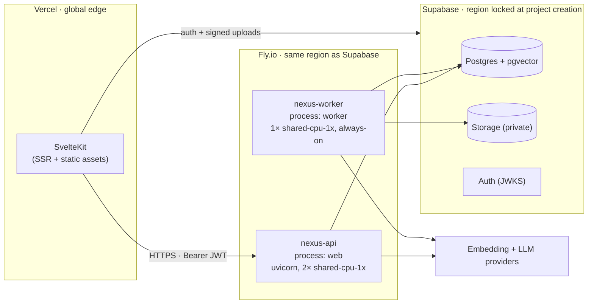
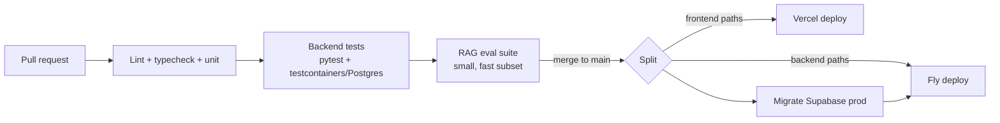

# NEXUS — Deployment

Status: **design (spec phase)** — no infrastructure provisioned yet
Target: SvelteKit on **Vercel** · FastAPI + worker on **Fly.io** · Postgres/Storage/Auth on **Supabase**

---

## 1. Topology



Three deployables, three deploy triggers, one database.

---

## 2. Environments

| Env | Frontend | Backend | Supabase | Purpose |
|---|---|---|---|---|
| `local` | `vite dev` :5173 | `uvicorn --reload` :8000 | local Supabase CLI stack (docker) **or** a dedicated cloud dev project | Day-to-day |
| `preview` | Vercel preview per PR | Fly app `nexus-api-preview` (optional) or pointed at dev | Dedicated dev project | PR review |
| `production` | Vercel prod domain | Fly `nexus-api` | Production project | Live |

Rules:
- **Never** point a preview deployment at the production database. Preview env vars come from Vercel's Preview scope only.
- Migrations are applied to `local` → `dev` → `production`, in that order, never the reverse.
- Local development uses the Supabase CLI stack so `pgvector`, RLS, and storage policies behave identically to production.

---

## 3. Supabase setup

1. Create project. **Choose the region once** — it cannot be changed later, and every backend round trip pays for a wrong choice. For a PH-based user, `ap-southeast-1` (Singapore) or `ap-northeast-1` is the right neighbourhood; put Fly machines in the *same* region.
2. Enable extensions: `vector`, `pgcrypto`, `pg_trgm`.
3. Run migrations (§6) — schema, RLS, `hybrid_search`.
4. Create a **private** storage bucket `nexus-documents`; add the `auth.uid()` path policy.
5. Auth: enable email + one OAuth provider (Google is the pragmatic first). Set the site URL and redirect allow-list to the Vercel production domain **and** `http://localhost:5173` for dev.
6. Collect: project URL, anon key, service-role key, JWT verification config, direct DB connection string (for migrations).

---

## 4. Fly.io setup

**One Fly app, two process groups** — same image, different commands. This keeps build/deploy atomic: API and worker can never run mismatched code versions.

```toml
# fly.toml (shape)
app = "nexus-api"
primary_region = "sin"                  # co-located with Supabase

[build]
  dockerfile = "backend/Dockerfile"

[env]
  ENVIRONMENT = "production"

[http_service]
  internal_port = 8000
  force_https = true
  auto_stop_machines = "stop"
  auto_start_machines = true
  min_machines_running = 1
  processes = ["web"]

[[vm]]
  size = "shared-cpu-1x"
  memory = "512mb"

[processes]
  web    = "uvicorn app.main:app --host 0.0.0.0 --port 8000 --workers 2"
  worker = "python -m app.worker.main"
```

Notes:
- **`worker` must never scale to zero.** It is the thing that makes uploads progress; `auto_stop_machines` applies only to `web`.
- Concurrency: the worker claims `WORKER_CONCURRENCY` jobs (default 2) and respects a `FOR UPDATE SKIP LOCKED` claim, so a crash mid-job is recoverable via the staleness sweeper.
- `web` keeps `min_machines_running = 1` to avoid cold-start latency on the first chat after idle.
- Health check on `/health`; the worker exposes no port and instead writes a heartbeat row / logs every N seconds so a dead worker is visible.

### Secrets (Fly)

```bash
fly secrets set \
  SUPABASE_URL=… \
  SUPABASE_ANON_KEY=… \
  SUPABASE_SERVICE_ROLE_KEY=… \
  SUPABASE_JWT_SECRET=… \
  DATABASE_URL=… \
  OPENAI_API_KEY=… \
  SENTRY_DSN=…
```
Secrets are shared by both process groups. The service-role key and AI keys exist **only** here — never in Vercel.

### Deploy

```bash
fly deploy                       # builds once, rolls web + worker
fly logs -a nexus-api
fly status
```
Release command runs migrations (`fly.toml [deploy] release_command`), so schema changes ship with the code that needs them — with the caveat that a failing migration aborts the deploy rather than leaving half-applied state.

---

## 5. Vercel setup

- Framework preset: **SvelteKit** (auto-detected). Node version pinned via `.nvmrc` / `engines`.
- Environment variables, Production + Preview scopes separately:

| Variable | Exposure |
|---|---|
| `PUBLIC_SUPABASE_URL` | public |
| `PUBLIC_SUPABASE_ANON_KEY` | public |
| `PUBLIC_API_BASE_URL` | public |

- **No service-role key, no AI keys, no `DATABASE_URL`.** If one appears in a Vercel env, that is a security bug, not a configuration choice.
- SvelteKit SSR calls FastAPI with an absolute URL (`PUBLIC_API_BASE_URL`). Browser-side calls use the same absolute URL directly — FastAPI sets CORS to allow exactly the Vercel domains and `localhost:5173`, never `*`.
- Preview deployments get their own `https://*.vercel.app` origin; CORS uses an explicit allow-list pattern for the project's preview domain.

---

## 6. Migrations

- Location: `supabase/migrations/NNNN_description.sql`, applied with the Supabase CLI.
- Forward-only. Every migration is reviewed for lock behaviour: `CREATE INDEX CONCURRENTLY` on any table that could already hold data, no table rewrites on `documents`/`chunks`.
- RLS policies ship in their own migration so the security posture is reviewable in isolation.
- Seed script creates two users and a small corpus for local testing.

---

## 7. CI/CD



Gates that must block a merge: typecheck, unit tests, RLS cross-tenant tests, eval set showing no recall regression.

---

## 8. Observability

| Need | MVP choice | Upgrade path |
|---|---|---|
| Structured logs | JSON to stdout, Fly captures | Ship to a log sink |
| Errors | Sentry (both services) | — |
| Metrics | `/health` + periodic heartbeat + `usage_events` table | Prometheus/Grafana once there is traffic to graph |
| Slow queries | `pg_stat_statements` | Supabase query insights |
| RAG quality | `query_log`/`retrieval_debug` + feedback endpoint | Dashboards over grounded-rate |

Deferred deliberately (ADR-007): Prometheus, Grafana, Redis. They are in the reference diagram for a system with sustained multi-tenant load, not a pre-launch product.

The one metric worth building first: **grounded-answer rate** (share of chat turns with `grounded:true` and ≥1 citation). It is the product's core promise expressed as a number.

---

## 9. Backups & recovery

- Supabase daily automated backups (PITR on paid tier if the data becomes irreplaceable).
- Storage: originals are user data — an export path (signed bulk download) is a v1.1 feature, since "your knowledge, retrievable" is the promise.
- Documented restore drill: restore to a scratch project, point a Fly preview app at it, verify a chat answer cites correctly. An untested backup is a rumour.
- Deleting a document is soft for 30 days (`deleted_at` + purge job), so an accidental delete is not a data-loss incident.

---

## 10. Configuration reference

| Variable | Service | Required |
|---|---|---|
| `ENVIRONMENT` | API, worker | ✅ |
| `SUPABASE_URL` | API, worker | ✅ |
| `SUPABASE_ANON_KEY` | API (RLS-bound client) | ✅ |
| `SUPABASE_SERVICE_ROLE_KEY` | worker, API system ops | ✅ |
| `SUPABASE_JWT_SECRET` | API | ✅ |
| `DATABASE_URL` | API, worker | ✅ |
| `OPENAI_API_KEY` | API, worker | ✅ |
| `PINNED_EMBEDDING_MODEL` / `_DIM` | both | ✅ |
| `LLM_MODEL` | API | ✅ |
| `RETRIEVAL_K`, `SCORE_FLOOR`, `MMR_LAMBDA` | API | defaults in code |
| `WORKER_CONCURRENCY` | worker | default 2 |
| `MAX_UPLOAD_BYTES` | API | default 50 MB |
| `CORS_ALLOWED_ORIGINS` | API | ✅ |
| `SENTRY_DSN` | both | optional |
| `PUBLIC_SUPABASE_URL` / `_ANON_KEY` / `PUBLIC_API_BASE_URL` | Vercel | ✅ |

Rule: a secret is stored in exactly one place per environment, and the code fails to start (not degrades) when a required one is missing. A backend that silently runs without an embedding key will happily produce an index nobody can search.
